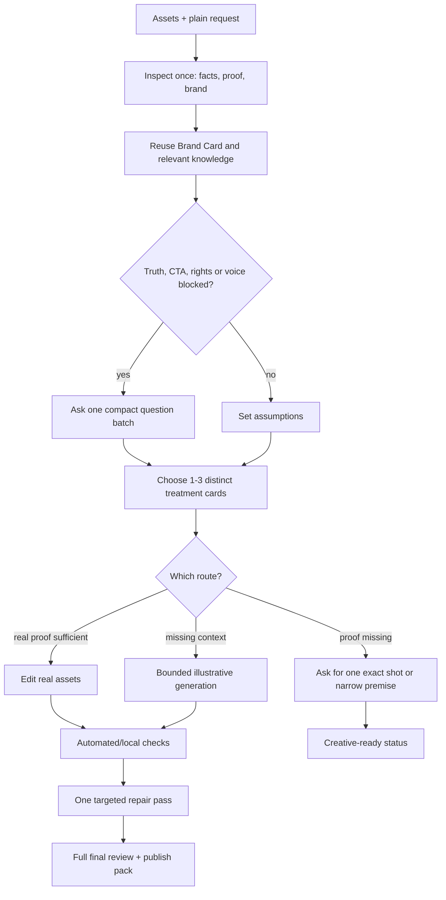

# Output options and efficient production

Social House should give a business owner creative choice without asking them to become the creative director or paying to render three complete films by default.

## Three genuinely different directions

Offer at most three treatments when the brief or brand evidence supports a real choice. Each changes the creative grammar, not only a font:

1. **Product proof:** real product, satisfying action, clean graphic design, specific buyer copy.
2. **Editorial context:** product proof paired with a proposed setting/person/story; generated context is clearly illustrative.
3. **Motion-led idea:** product macro plus purposeful typography, diagrams, graphic transitions or object animation that explains the buyer value.

These are starting lanes, not fixed templates. Select alternatives that fit the actual brand and product. They may use different typography, palette treatment, setting, pacing, voice and sound, but every factual claim must stay anchored to the same evidence.

Each option card states: premise/hook, buyer and CTA, visual world/background, type direction, voice/language/emotion, sound plan, generated assets needed, truth/rights caveat, success signal and relative production cost. Mark one `recommended` with a reason.

## Match production depth to the request

- **Normal “make this” request:** deliver one complete recommended asset. Include up to two lightweight alternatives, such as cover/opening treatments or a short design board, so the owner can swap a direction without regenerating the whole piece.
- **Ambiguous creative direction or explicit “show me options”:** show up to three treatment cards/previews first. Use crops from supplied media and locally rendered type/colour samples where possible. Ask the owner to pick one before expensive image, video or voice generation. If a route depends on generated model/location scenes and permission is unclear, ask once whether illustrative AI context is acceptable.
- **Explicit request for multiple finished versions:** produce up to three only when budget/access allows; keep the proof, product facts and CTA consistent, and vary the declared creative system. State expected additional provider cost before generation if material.

Do not silently turn one request into three full videos. Do not present three near-identical options. If one direction clearly fits the brief, give one strong final and optional low-cost variations rather than manufacturing choices.

## Audio and trend decision

Make an audio decision before scripting:

1. Is voice necessary? Select voice-led, natural/product sound, music-led or silent design based on the story.
2. If voice helps, set language/accent, gender if requested, emotional intent, pace and pronunciation from audience and brand evidence. If language or speaker type cannot be inferred and materially changes the result, ask one compact question with a recommended default.
3. If recommending current Instagram audio, check it close to production for target region, recent use/momentum, fit with the content, account availability and commercial eligibility. Use current account-visible Reels/audio surfaces where available. Agent Reach may find accounts/posts; it does not by itself prove audio ranking or rights. Add the chosen track natively when needed and provide a clean master.
4. If current audio cannot be verified, say so. Ask for a user-selected track or use an original/cleared alternative; never fabricate a trend result.
5. For paid/boosted use, verify commercial rights separately. Trend status is not a licence.

For reach/engagement research, inspect a small, recent set of posts from the same buyer category and region, then name the visible creative mechanics and available signals. Public views/likes are clues, not causal proof. Prefer the business's own saves, shares, completion, profile visits and qualified messages when available. Match the success signal to the post's job; never promise reach, followers or leads from an audio choice.

Do not make the owner choose arbitrary music genres or voice settings when source content makes a good default clear. Put the audio direction in the recommended option, then ask only for a decision that affects voice, rights or platform use.

## Context questions: one compact decision batch

Use what is supplied and available. Ask only for missing information that changes the result. When relevant, combine:

- buyer/region or desired response route;
- voice language or whether to omit voice;
- permission for AI-generated **illustrative** model/location imagery;
- organic-only versus paid/boosted use, which changes audio rights.

Offer a recommended default for each. Do not ask the user to repeat product facts visible in their assets. If generated scenes are declined, continue with real footage and graphic motion. If permission is unclear, show the options and hold only that generation until answered.

## Token and tool budget

Optimize total cost for a quality gate passed, not token count alone. Token usage is provider/session-dependent; report exact tokens only when telemetry exposes them. Otherwise report bounded actions and external credits, not invented token savings.

### Cheap path

1. Read the entry skill and the short dispatch once. Load only the specific reference sections that affect this job. Never reread the entire expert-feedback corpus when headings or targeted search can answer the relevant question; preserve its source and apply the relevant rules.
2. Inspect each asset once. Reuse a compact fact/asset ledger and provisional Brand Card through the job. Reinspect only when new media or correction arrives.
3. Research trends only when the format uses a current trend or the user asks for one. Search one target region/audience and a small recent set of relevant posts/audio surfaces; stop when the choice is verified or access is blocked. Record date and surface. Cache dated evidence, not a claim of permanent popularity.
4. Draft one script and one beat map. Map every spoken phrase to voice timing/emotion, visible proof, on-screen copy, movement/cut and music or natural-sound cue. Narration must describe or deepen the image in that interval. Do not write multiple complete scripts unless options are requested.
5. Use local templates/code for type, captions, crop, transitions and export. Never spend image-generation calls to render text.
6. Generate only assets named in the selected treatment. Initial default: up to two support stills, one short motion test and two directed voice takes. Do not render unused alternates.
7. Run deterministic checks first (dimensions, duration, audio streams, black frames, text collisions/contact sheets where available). Use a model or human review for judgement, not for checks a script can settle.
8. Keep one production/review owner. No extra agent call by default. Log defects, fix the smallest failed part, then recheck the complete export once.

## Error repair protocol

Classify each defect before changing anything:

| Defect | First repair |
| --- | --- |
| Product truth / generation drift | Replace with real proof, constrain generation once, or narrow the premise |
| Copy / voice / language | Rewrite only affected line; regenerate only that voice segment/take |
| Timing / transition / sound collision | Adjust affected edit/audio interval and handoff |
| Font / contrast / placement / overlap | Change type role, position, contrast or shot; scan full hold again |
| Export / codec / missing media | Fix pipeline or source; rerender and inspect metadata |
| Trend / rights / availability | Remove claim/track or use verified platform-native/cleared alternative |

Maintain a short defect log: `time/slide; defect; cause; smallest fix; recheck result`. One targeted correction pass is default. If the same defect survives, change concept/tool or request the exact missing source. Never rerender the whole piece repeatedly to compensate for an unclear decision. Full final playback remains mandatory after local repairs.

## Measure efficiency honestly

For representative jobs, record only: deliverable, source count, questions asked, references opened, generator calls, voice takes, render/repair count, external credits/cost, exposed token usage if available, review defects, final status. Compare like jobs over time. Reduce a step only when quality gates still pass; do not claim efficiency gains from shorter prompts alone.
